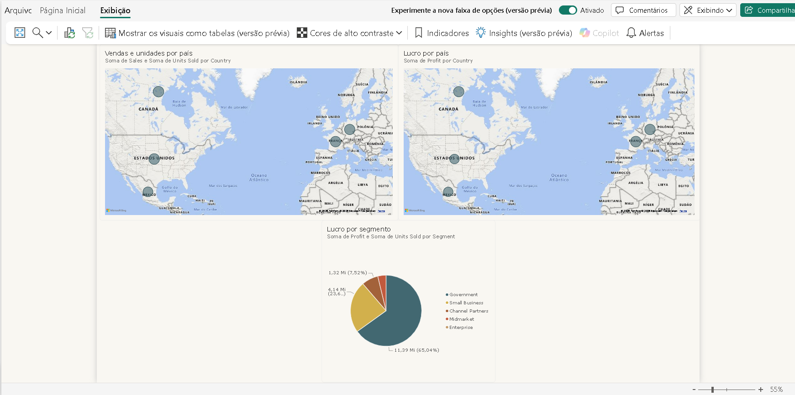

# Power BI · Desafios da DIO.me

Repositório com os desafios do curso de Power BI da DIO.me, mostrando minha evolução na ferramenta: do primeiro relatório replicado até um relatório interativo com navegação entre páginas, segmentadores e botões que alternam visuais sobre o mesmo assunto.

## Evolução

| Desafio | Foco principal | Base | Destaques |
|---|---|---|---|
| [Desafio 1](#desafio-1--visuais-com-a-base-financial-sample) | Replicar duas páginas e criar uma terceira do zero | Financial Sample | Mapas, gráfico de pizza, Power Query |
| [Desafio 2](#desafio-2--relatório-interativo-com-navegação) | Relatório de duas páginas com navegação e interação | Financial Sample | Botões de navegação, segmentadores, indicadores, botões que alternam visuais |

**Tecnologias:** Power BI Desktop · Power Query (linguagem M)

---

## Desafio 1 · Visuais com a base Financial Sample

Primeiro desafio do curso. A proposta foi replicar duas páginas e criar uma terceira página do zero, com visuais de vendas, unidades e lucro.



### Visuais da página 3

| Visual | Tipo | Campos principais | Dicas de ferramenta |
|---|---|---|---|
| Vendas e unidades por país | Mapa | Localização: Country · Tamanho: Sales | Units Sold |
| Lucro por país | Mapa | Localização: Country · Tamanho: Profit | - |
| Lucro por segmento | Gráfico de pizza | Legenda: Segment · Valores: Profit | Units Sold |

### Como reproduzir

1. Abra `desafio-1/Desafio1_PowerBI_Thalia.pbix` no Power BI Desktop.
2. Se aparecer o aviso de atualização de dados, aponte a fonte para `desafio-1/Financial_Sample.xlsx`.
3. Para ver a transformação aplicada, use **Página Inicial > Transformar dados > Editor Avançado** e compare com `desafio-1/codigo_power_query.txt`.

**Observação:** na importação, a coluna " Sales" foi renomeada para "Sales", retirando o espaço inicial.

**Relatório publicado:** [Power BI Service](https://app.powerbi.com/links/WQrOGxxBKe?ctid=659ce2b8-0714-4198-8c38-dc9b60aabb57&pbi_source=linkShare)

---

## Desafio 2 · Relatório interativo com navegação

Segundo desafio do curso: um relatório de duas páginas sobre a base Financial Sample, com navegação entre páginas, segmentadores e botões que alternam visuais sobre um mesmo assunto.

### Página 1 · Report de Lucro Detalhado


- Árvore de decomposição do lucro por ano e país
- Medidor (gauge) do lucro total
- Lucro por produto, por segmento (treemap) e por trimestre (waterfall)
- Segmentadores de Year e Country

### Página 2 · Sales Report


- Segmentador de período
- Cards com Sales, Units Sold, Discounts, COGS e Profit
- Vendas por mês em gráfico de área
- Vendas por segmento, com botões para alternar entre gráfico de barras e rosca
- Vendas por produto
- Vendas por país, com botões para alternar entre árvore e mapa

### Demonstração


A demonstração mostra a navegação entre as páginas e o funcionamento dos botões, que trocam os visuais de segmento e de país sobre o mesmo assunto.

### Recursos utilizados

- Navegação entre páginas por botões com seta
- Segmentadores para filtrar os dados
- Botões com imagem associada
- Indicadores para alternar visuais sobre o mesmo assunto

**Relatório publicado:** [Power BI Service](https://app.powerbi.com/links/0ut62lCS-f?ctid=659ce2b8-0714-4198-8c38-dc9b60aabb57&pbi_source=linkShare)

### Como reproduzir

1. Abra `desafio-2/Desafio2_PowerBI_Thalia.pbix` no Power BI Desktop.
2. Se aparecer o aviso de atualização de dados, aponte a fonte para `desafio-2/Financial_Sample.xlsx`.

---

## Aprendizados

- No desafio 1, aprendi a criar visuais de mapa e pizza e a transformar dados no Power Query.
- No desafio 2, organizei o relatório em páginas e criei interação com segmentadores e botões, em vez de apenas visuais isolados.
- Entendi a importância de planejar a estrutura de páginas antes de montar os visuais.

## Estrutura do repositório

```
power-bi-dio-desafios/
├── README.md
├── desafio-1/
│   ├── Desafio1_PowerBI_Thalia.pbix
│   ├── Financial_Sample.xlsx
│   ├── codigo_power_query.txt
│   └── print_pagina3.png
└── desafio-2/
    ├── Desafio2_PowerBI_Thalia.pbix
    ├── Financial_Sample.xlsx
    ├── print_pagina1.png
    ├── print_pagina2.png
    └── navegacao.gif
```

## Autora

**Thalia Menezes** · [GitHub](https://github.com/thaliamenezes-98) · [LinkedIn](https://www.linkedin.com/in/thalia-menezes/)
